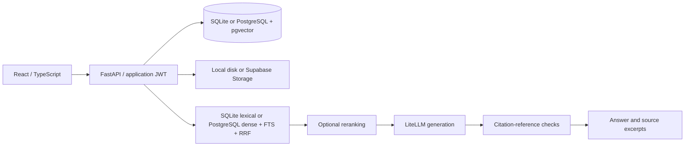

# DocuMind — AI Document Intelligence

[](https://github.com/salimtagemouati/documind/actions/workflows/ci.yml)

DocuMind is a document intelligence application for uploading PDF, DOCX, TXT and Markdown files, reviewing summaries and extracted entities, and asking questions with source excerpts. Its React/TypeScript frontend talks to a FastAPI backend; SQLAlchemy stores application data in SQLite locally or PostgreSQL with pgvector for hosted deployments. LiteLLM provides generation and embeddings. Supabase Storage and Redis are optional integrations, and Stripe supports subscription workflows.

## How it works

1. The API validates an upload, stores the original, extracts text, chunks it, and generates analysis in an in-process background task. PDF pages and DOCX tables are retained where possible; scanned PDFs need OCR before upload.
2. PostgreSQL retrieval combines cosine similarity from 768-dimensional pgvector embeddings with an independent English full-text search using reciprocal rank fusion. SQLite uses a local lexical fallback. Optional LLM reranking is disabled by default.
3. The generator receives retrieved passages as untrusted data and is asked to answer with source references. Deterministic checks reject malformed source IDs and incorrect page references, insert known omitted pages, and return an abstention or retry message when evidence or references are unusable.
4. The API returns the answer and ordered source excerpts. A valid reference confirms only that its number and page match a retrieved chunk; it does **not** prove that a claim is supported. Prompt separation is a defense in depth, not a guarantee against injection.



The UI includes document upload and analysis, single-document chat with bounded history, cross-document questions, and a read-only demo with seeded fictional documents. API routes and retrieval queries check document ownership. Database RLS and storage controls require deployment-specific verification; the local tests are not a production security attestation.

## Local development

Requires Python 3.11+ and Node.js 22.12+. From a clone:

```bash
python3 scripts/setup_local.py
cd backend
python3 -m venv .venv
source .venv/bin/activate
pip install -r requirements.txt
uvicorn app.main:app --reload --port 8000
```

In another terminal:

```bash
cd frontend
npm ci
npm run dev
```

Open `http://localhost:5173/demo` for the seeded read-only workspace. `setup_local.py` creates local configuration with a random signing secret and preserves existing `.env` files. The fixture analyses are pre-authored; demo questions and new document analyses require a usable AI provider. Local SQLite retrieval is lexical and is not a test of pgvector or embeddings. See [local development](docs/LOCAL_DEV.md) for details.

A local Docker stack is also available with `python3 scripts/setup_local.py` followed by `docker compose up --build`. It uses SQLite and a persistent local volume. See [deployment notes](docs/DEPLOYMENT.md) for hosted configuration; this repository does not assert that a public deployment is currently live.

## Model configuration

Settings are loaded from `backend/.env` or the process environment. The generated local configuration and [backend example](backend/.env.example) use placeholders; never commit credentials. For local SQLite and Gemini generation, the relevant settings are:

```dotenv
SECRET_KEY=replace-with-a-long-random-secret
ENVIRONMENT=development
DATABASE_URL=sqlite+aiosqlite:///./dev.db
SUPABASE_URL=https://unused.invalid
SUPABASE_ANON_KEY=
SUPABASE_SERVICE_KEY=
STORAGE_BACKEND=local
REDIS_URL=
GOOGLE_API_KEY=replace-with-your-google-api-key
LLM_MODEL=gemini/gemini-3.5-flash-lite
EMBEDDING_MODEL=gemini/gemini-embedding-001
EMBEDDING_DIM=768
ENABLE_RERANKING=false
```

Gemini remains the default. For the optional managed Groq GPT-OSS generation route, set the following after reviewing provider access, privacy and cost:

```dotenv
GROQ_API_KEY=replace-with-your-groq-api-key
ENABLE_GROQ_GPT_OSS=true
GROQ_GPT_OSS_MODEL=groq/openai/gpt-oss-120b
ENABLE_GEMINI_FALLBACK=false
GEMINI_FALLBACK_MODEL=gemini/gemini-3.5-flash-lite
```

Setting `ENABLE_GEMINI_FALLBACK=true` allows one Gemini fallback attempt after a transient Groq failure; the primary provider's limiter may retry first. Keep the Google key available for Gemini embeddings and any configured fallback. Reranking uses `LLM_MODEL` separately. This optional route has mock regression tests but has not been validated by a live GPT-OSS benchmark. Do not change the embedding model or vector dimensions for an existing index without planning re-embedding and migration.

Hosted PostgreSQL, Supabase Storage, Redis and Stripe require additional configuration. See [deployment](docs/DEPLOYMENT.md) and [go-live notes](docs/GO_LIVE.md). Service credentials and database URLs are server-side only.

## Tests and local checks

```bash
cd backend
source .venv/bin/activate
ruff check app/ tests/ --select E,F,I --ignore E501
mypy app/services/rag_service.py app/services/rerank_service.py app/services/ai_service.py --follow-imports=skip --ignore-missing-imports
pytest tests/ -q --cov=app --cov-report=term-missing --cov-fail-under=60
python ../scripts/smoke_test.py

cd ../frontend
npm run lint
npm test
npm run build
```

Backend tests use test configuration and mock AI and Supabase calls. The process smoke test uses disposable SQLite. A separate local PostgreSQL integration check, `backend/.venv/bin/python scripts/check_pgvector.py`, requires Docker and uses a disposable container and deterministic vectors. CI runs backend and frontend checks, the local smoke and retrieval checks, PostgreSQL integration, and a container build. Passing these checks does not establish live-provider quality or deployed service health.

## Offline evaluation

The provider-neutral harness defaults to a dry run and never calls a provider in dry-run or mock mode. This example uses the frozen 12-question development pilot and makes **no API requests**:

```bash
backend/.venv/bin/python scripts/evaluate_models.py --dry-run --dataset eval/datasets/pilot_dev_v1/dataset.json --mode generation --split dev --max-output-tokens 2048 --timeout 60 --max-requests 36 --max-estimated-usd 1
```

For a local mock run, replace `--dry-run` with `--mock` and add `--output-dir eval/runs/dev-mock`. Outputs under `eval/runs/` are ignored and may contain source text and answers. The end-to-end diagnostic uses synthetic text and SQLite lexical retrieval; it does not measure production pgvector/HNSW. The harness records reference validity, errors, timing and available token usage, but correctness, abstention and claim support require human review. Live calls require explicit authorization, credentials, provider/privacy checks and spending controls; the local estimated budget is not a guaranteed billing cap. See [live evaluation instructions](docs/LIVE_MODEL_EVALUATION.md), the [benchmark protocol](docs/MODEL_BENCHMARK_PROTOCOL.md), and the [blinded review rubric](docs/BLINDED_REVIEW_RUBRIC.md).

The older 15-case in-memory artifact is historical and its aggregate results were invalidated by a prior Precision@K error. It is not evidence of current accuracy, production retrieval quality, or a reranking gain. No reviewed live GPT-OSS comparison has been completed. See [historical evaluation limitations](docs/EVALUATION_REPORT.md) and the [model comparison](docs/MODEL_COMPARISON.md).

## Engineering improvements — October 2026

- Added owner checks, safer demo behavior, bounded upload and parsing checks, and local PostgreSQL/tenant-isolation tests.
- Added reference and page validation, explicit abstentions, untrusted-evidence prompts, reranking/fallback telemetry and model-aware answer caching.
- Added an opt-in Groq route with bounded Gemini fallback while preserving Gemini and 768-dimensional embeddings by default.
- Added a frozen synthetic evaluation dataset, a separate development pilot, offline/mock runs with request and estimated-spend controls, resumable journaling and blinded review tooling.

These changes do not establish semantic claim support or complete production readiness. Remaining priorities include atomic quota enforcement, Stripe event reconciliation, durable isolated document processing, deployed RLS/storage verification, independent label and claim review, and representative live evaluation. See the [2026 audit](docs/AUDIT_2026.md), [improvement roadmap](docs/IMPROVEMENT_ROADMAP.md), [RAG evaluation plan](docs/RAG_EVALUATION_PLAN.md), [benchmark audit](docs/MODEL_BENCHMARK_AUDIT.md), [pilot review packet](docs/PILOT_DEV_REVIEW_PACKET.md), and [provider-readiness checklist](docs/PROVIDER_READINESS_CHECKLIST.md).

## Project layout

```text
backend/app/        API, authentication, models, document processing and RAG
backend/tests/      Backend tests and evaluation-tool regression tests
backend/migrations/ PostgreSQL billing and pgvector migrations
frontend/src/       React UI and API client
scripts/            Local setup, checks, evaluation and deployment helpers
eval/datasets/      Frozen synthetic datasets and checksums
docs/               Architecture, audits, evaluation and operations
```

Additional references: [architecture](docs/ARCHITECTURE.md), [engineering audit](docs/ENGINEERING_AUDIT.md), and [project showcase](docs/PROJECT_SHOWCASE.md).

## License

[MIT](LICENSE).
