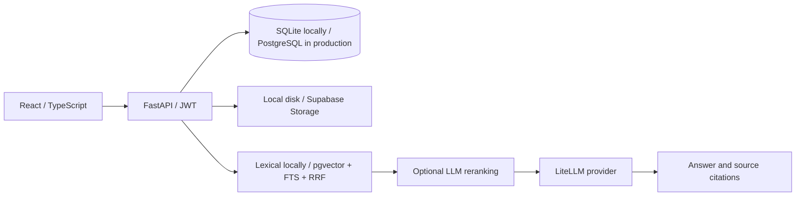

# DocuMind — AI Document Intelligence

[](https://github.com/salimtagemouati/documind/actions/workflows/ci.yml)

Upload documents, inspect summaries and extracted entities, and ask questions with source citations. Built with React, TypeScript, FastAPI, SQLAlchemy and LiteLLM. PostgreSQL deployments support pgvector and hybrid lexical/vector retrieval; local development uses SQLite.

## Try it locally

Requires **Python 3.11+** and **Node.js 22.12+**. Run these commands from a clone of this repository:

```bash
python3 scripts/setup_local.py
cd backend
python3 -m venv .venv
source .venv/bin/activate
pip install -r requirements.txt
uvicorn app.main:app --reload --port 8000
```

In a second terminal, from the repository root:

```bash
cd frontend
npm ci
npm run dev
```

Open **http://localhost:5173/demo** to explore three seeded sample documents without creating an account. The setup script generates a random signing secret and preserves existing `.env` files.

| Capability | Local requirements |
| --- | --- |
| Landing page, registration, sign-in, demo analyses, document listing | No external services or provider credentials |
| Upload and store PDF, DOCX, TXT or Markdown files | Local SQLite and private disk storage, created automatically |
| Generate summaries, entities, sentiment and answers | A valid credential and model for your chosen AI provider |
| Semantic retrieval, PostgreSQL full-text search and RRF | PostgreSQL with pgvector, migrations and embedding credentials |
| Shared cache and progress events across workers | Redis; local single-process mode works without it |
| Paid subscriptions | Optional Stripe configuration; disabled by default |

For AI generation, edit `backend/.env` and set `GOOGLE_API_KEY` with a model your account can access, or configure another LiteLLM provider using `LLM_MODEL` and its corresponding key. Never commit credentials. Uploaded documents fail visibly if all AI analysis calls fail; the app does not manufacture analysis results.

The sample analyses are pre-authored fixtures. Demo questions call the configured provider; they are not canned answers. SQLite retrieval is lexical and does not validate the production vector-search path.

## Verification status — October 2026

A complete live Gemini Flash Lite + PostgreSQL/pgvector run passed PDF, Markdown, adversarial TXT and DOCX table uploads, analysis, cited answers, follow-up, refusal, multi-document synthesis, caching and deletion. Earlier quota/timeout failures are preserved in dated artifacts; see the [latest passing raw run](docs/live_gemini_results.json) and [audit](docs/ENGINEERING_AUDIT.md).

Six reproducible synthetic retrieval fixtures retained 6/6 retrieval hits while supporting-page accuracy improved from 0/6 to 6/6. This is a provenance measurement, not a general factuality benchmark. Optional reranking is disabled by default pending representative evidence. Analysis combines summary, entities, sentiment and keywords into one validated generation call.

```sh
backend/.venv/bin/python scripts/evaluate_local.py
# Requires local Docker; no provider credentials:
backend/.venv/bin/python scripts/check_pgvector.py
# Explicit live test: sends synthetic documents to Gemini using backend/.env:
backend/.venv/bin/python scripts/live_gemini_smoke.py
```

PDF physical pages and DOCX tables are preserved. Sources include full retrieved passages. Single-document chat accepts up to three bounded prior turns. Scanned PDFs need OCR before upload. Ingestion is currently in-process and not durable across restarts; see release blockers in the audit.

Launch instructions: [GO_LIVE.md](docs/GO_LIVE.md). Current checks: 118 backend tests (61.55% coverage) and 7 frontend tests pass. Permanent cloud hosting remains unconfigured.

## Hosted demo status

An account-free temporary HTTPS preview can run the complete application on this Mac. It uses the existing backend credential, a separate persistent Docker PostgreSQL database, private local uploads and a built frontend served by FastAPI. Run `backend/.venv/bin/python scripts/preview.py start --share`, then `backend/.venv/bin/python scripts/preview.py status` for the current URL. Docker, installed dependencies and `cloudflared` must be available. The Mac must stay awake and connected; the URL changes after restart. This is a live preview, not permanent cloud hosting. See [preview operations](docs/GO_LIVE.md).

On macOS, an optional login service restarts the preview after exit and at login:

```sh
backend/.venv/bin/python scripts/preview_service.py install
backend/.venv/bin/python scripts/preview_service.py status
# Stop the service and preserve its database/uploads:
backend/.venv/bin/python scripts/preview_service.py remove
```

Docker must remain running. To verify a shared preview with synthetic uploads and real provider calls, run `backend/.venv/bin/python scripts/check_preview.py`. The public URL is temporary, so it is intentionally not advertised as a permanent deployment link.

## Docker

```bash
python3 scripts/setup_local.py
docker compose up --build
```

Open http://localhost:5173. Compose runs the API, Vite and Redis, with a persistent `api_data` volume for SQLite and uploaded originals. This is a local development stack. `docker compose down` retains data; removing volumes erases it. The hosted design uses PostgreSQL and Supabase Storage. `STORAGE_BACKEND=local` also supports PostgreSQL with persistent private disk storage for local integration testing.

## Main workflows

- **Document processing:** validate size/type, store the original, extract text, chunk, index, then generate analysis in background.
- **Document Q&A:** retrieve owner-filtered evidence, optionally rerank, generate a cited answer, and retain history for registered users.
- **Cross-document Q&A:** select multiple documents and retrieve balanced evidence across them.
- **Public demo:** three fictional sample documents, read-only access and per-IP query limits.
- **Quality panel:** inspect the historical evaluation artifact with an explicit methodology warning.



PostgreSQL embeddings use 768 dimensions and a cosine HNSW index. Tenant checks are performed by the API and retrieval queries. Access tokens are checked against current database accounts, and the shared demo identity cannot use ordinary password login or write operations.

## Verify the project

```bash
cd backend
source .venv/bin/activate
ruff check app tests
mypy app/services/rag_service.py app/services/rerank_service.py app/services/ai_service.py --follow-imports=skip --ignore-missing-imports
pytest tests -q --cov=app --cov-report=term-missing --cov-fail-under=60
python ../scripts/smoke_test.py

cd ../frontend
npm ci
npm run lint
npm test
npm run build
```

The smoke test starts a real API process against disposable SQLite, without reading your `.env`. It checks readiness, demo seeding, analysis responses, write protection, registration and tenant isolation. Unit/integration tests mock AI and Supabase calls; passing them does not establish live provider or hosted deployment health.

GitHub Actions runs backend lint/type checks/tests, the process smoke test, local provenance evaluation, disposable PostgreSQL integration, frontend lint/build and a backend Docker build.

## Evaluation limitations

The historical 15-case artifact predates a corrected Precision@K formula, so its aggregate values must not be presented as validated results. The harness compares in-memory dense retrieval with dense retrieval plus reranking. It does not test PostgreSQL, HNSW, FTS, RRF, tenant isolation or multi-document balancing. Groundedness uses lexical overlap, not an independent factuality judge.

To rerun with working provider credentials:

```bash
cd backend
python -m app.eval.runner --cases 3
```

See [evaluation methodology](docs/EVALUATION_REPORT.md) for formulas and limitations.

## Project layout

```text
backend/app/       API routes, authentication, models and RAG services
backend/tests/     Unit and integration tests
backend/migrations/ PostgreSQL billing and pgvector migrations
frontend/src/      React pages, dashboard components, API client and auth store
scripts/           Local setup, process smoke test, SQL schema and deployment helper
docs/              Local development, deployment and evaluation notes
```

More detail: [architecture](docs/ARCHITECTURE.md), [engineering audit](docs/ENGINEERING_AUDIT.md), [interview showcase](docs/PROJECT_SHOWCASE.md), [local development](docs/LOCAL_DEV.md), and [deployment](docs/DEPLOYMENT.md).

## License

[MIT](LICENSE).
