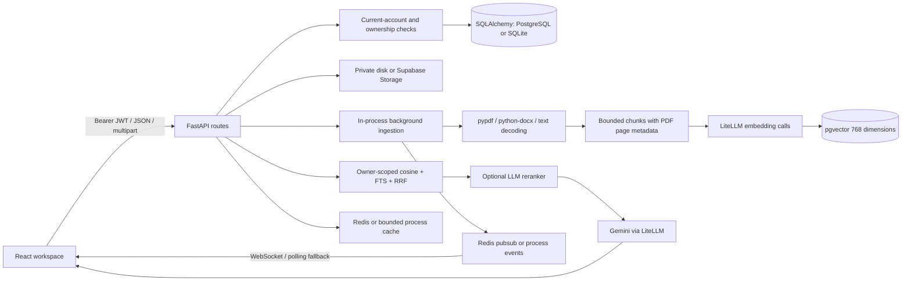
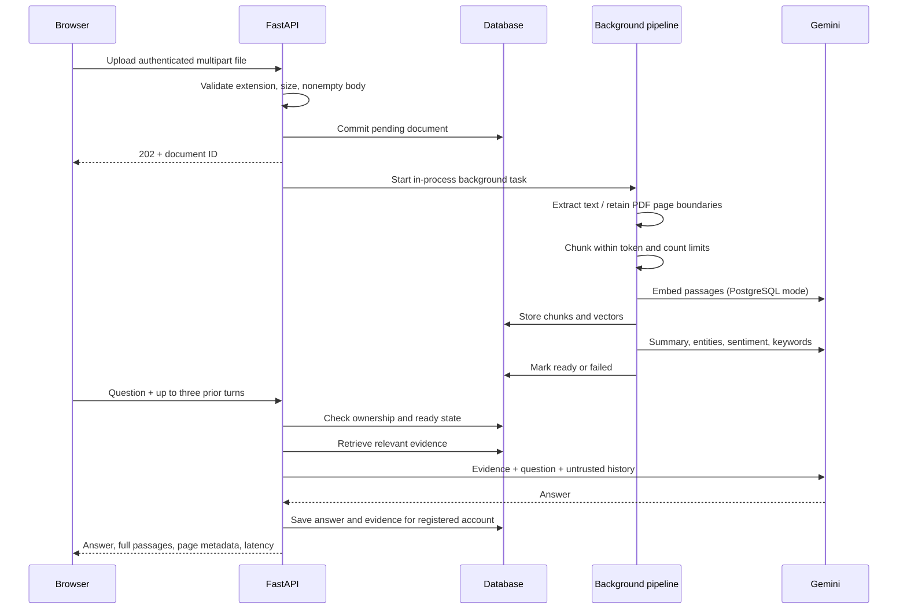

# DocuMind architecture

## Scope and execution modes

DocuMind is a React/TypeScript document workspace backed by FastAPI, SQLAlchemy and LiteLLM. It supports PDF, DOCX, TXT and Markdown ingestion, document analysis, single-document questions and cross-document synthesis. The browser never receives provider or storage administration keys.

SQLite provides a small local lexical-search mode. PostgreSQL with pgvector provides cosine search plus PostgreSQL full-text search, fused by reciprocal rank. These are different retrieval implementations, not equivalent quality guarantees. `STORAGE_BACKEND=auto` selects disk for SQLite and Supabase for PostgreSQL; `local` explicitly enables disk-backed PostgreSQL development. Use persistent private storage when deploying that mode.

## Responsibilities

| Component | Responsibility |
| --- | --- |
| `api/routes/auth.py`, `core/security.py` | Password authentication, JWT issuance/verification and current account status |
| `api/routes/documents.py` | Ownership, upload validation/storage, ingestion orchestration and deletion |
| `services/document_processor.py` | PDF/DOCX/text parsing and bounded source-preserving chunking |
| `services/rag_service.py` | Embeddings, index persistence, tenant-filtered retrieval and RRF |
| `services/ai_service.py` | Validated combined analysis, conversation context and grounded generation |
| `services/rerank_service.py` | Optional batched relevance scoring with retrieval-order fallback |
| `services/llm_limiter.py` | Concurrency control, bounded transient retries and per-call timeout |
| `services/cache_service.py` | Answer caching and document invalidation |
| `schemas/schemas.py` | Request limits and public response contracts |
| `frontend/src/services/api.ts` | Authentication headers, refresh handling, request timeouts |
| `frontend/src/components/dashboard` | Upload/list/analysis/chat/evidence and multi-document UI |

The ingestion orchestrator remains in the document route module. The implementation favors a small service layer over a framework-heavy pipeline. Extracting a durable job service is the next meaningful boundary, rather than adding abstract repositories around SQLAlchemy.

## Upload and answer flow

For single-document follow-ups, the last three questions help resolve references during retrieval. Prior answers are provided to generation as untrusted conversational context, not document evidence. Each prior question is limited to 1,000 characters and each answer to 4,000. The browser resets chat when document selection changes. Multi-document questions currently remain independent turns.

## Data and provenance

- Users own documents; documents own chunks. Query history contains answers and source excerpts.
- Analysis uses one structured provider call for summary, entities, sentiment and keywords by default (`ANALYSIS_MODE=combined`). Samples span up to 15 chunks, capped at 900 characters each; analysis is not exhaustive extraction. `separate` retains the earlier four-call mode.
- PDF extraction retains form-feed page boundaries, including blank pages. Chunks do not cross those boundaries. Physical page numbers are stored with chunks; DOCX has no reliable physical page numbering.
- Chunk contents are exact slices of normalized extracted text. Character spans are available during processing; persisted chunks retain content, ordinal, token count and page number.
- DOCX tables are extracted in document order. OCR, images, headers/footers, embedded objects and complex table-layout reconstruction are not implemented.
- Defaults: 800 tokens/chunk, 100-token overlap and 200 chunks/document. Excess chunk counts fail explicitly. PDF limit: 500 pages; expanded DOCX limit: 50 MB; extracted-text limit: 2 million characters.
- Token counts use `cl100k_base`, which is a budgeting approximation for Gemini, not Gemini billing usage. Response `tokens_used` is an estimate and excludes embeddings/reranking. Cost accounting is not yet implemented.
- PostgreSQL vector dimension is fixed at 768 in the ORM and migration. Changing the configured embedding dimension without a matching schema migration is unsupported; malformed provider vectors are rejected before indexing.
- Retrieval uses application ownership predicates. Optional reranking is disabled by default until representative measurements justify its latency/cost.
- All retrieved passages are shown as evidence. A displayed passage is not proof that every generated assertion is supported. Semantic claim-to-citation verification remains a separate evaluation requirement.

## Security boundaries

API JWTs are HS256 application tokens signed/verified with PyJWT, not Supabase Auth sessions. The algorithm is restricted to HS256. Current account status and database ownership checks are authoritative. The public demo identity is read-only. WebSockets require access tokens and an active account; refresh tokens are rejected. Login and registration have per-IP limits. Redis shares request-limit state across instances when configured.

The Supabase service key bypasses Storage RLS, so server-side ownership checks and private buckets are required; see [Supabase Storage access control](https://supabase.com/docs/guides/storage/security/access-control). The browser must never access the service key. Existing SQL policies have not been validated against a hosted Supabase instance during this audit.

Document excerpts, filenames and history are explicitly untrusted in the system prompt. This reduces instruction confusion; it is not a guarantee against prompt injection. This application gives the answering model no tools to execute document instructions. Model output is rendered as React text, not raw HTML.

Document deletion removes the stored original, chunks and saved single/multi-document query history referencing it. A failed storage removal returns an error and retains metadata for retry. Storage and SQL are not one transaction: an upload commit failure can leave an orphaned object, and deletion races still need durable reconciliation at production scale.

## Reliability and deployment trade-offs

- Background tasks run in the API process. They are not durable across process shutdown, crashes or scale-to-zero. Workspace reads mark jobs older than the processing deadline plus a 30-second grace interval as failed, scoped to the owner; the user can retry from the retained original. Long parser calls run off the event loop but do not have a separate process sandbox. A production deployment needs a persistent worker/queue and resource isolation for untrusted files.
- Ingestion has a configurable 120-second deadline and persists a failed state on timeout. Query generation has a 90-second deadline; each provider attempt has a 20-second timeout and at most three transient retries. Daily-quota exhaustion and retry delays over 60 seconds fail immediately. The browser permits 120 seconds for Q&A responses.
- Redis shares cache/progress across workers. The fallback cache has TTL, copy isolation and a 256-entry bound; it is process-local. Request limits share Redis state when Redis is configured; local mode uses process memory.
- `/health` verifies database connectivity. In production, `/ready` additionally checks API schema columns and configured Redis connectivity; it does not attest to provider quota, hosted Storage access or durable execution.
- The retained-document quota counts pending, failed and ready documents and locks the owner's row during upload on PostgreSQL. Deletion releases a slot; lifetime processing statistics remain unchanged. Daily query quotas still have check/increment races, and refresh tokens are not centrally revocable. Billing is implemented but payment/webhook behavior was not exercised live.
- Local tests use temporary databases and synthetic documents. Production rollout requires migration/backup rehearsal, hosted ownership tests, shared rate limiting, durable jobs and a live readiness run.

## Self-contained public preview

`scripts/preview.py` builds React with a relative `/api/v1` URL, mounts its output behind FastAPI, and optionally starts a Cloudflare Quick Tunnel. Browser WebSockets resolve against the same origin and use WSS over HTTPS. Missing API/assets and dotfiles return 404 instead of SPA HTML. A separate labeled Docker PostgreSQL container and private `backend/data/preview` directory persist data; it does not use the hosted Supabase project. In this single-process preview, caches, progress and limits use their in-memory fallback. No paid hosting is provisioned. The Mac, Docker and preview processes must remain running; Quick Tunnel URLs are temporary and have no production uptime guarantee.

Gemini 3+ requests retain Google's default sampling settings. Transient local attempt timeouts now receive the same bounded retries as provider timeout errors; daily quota failures still fail immediately.
